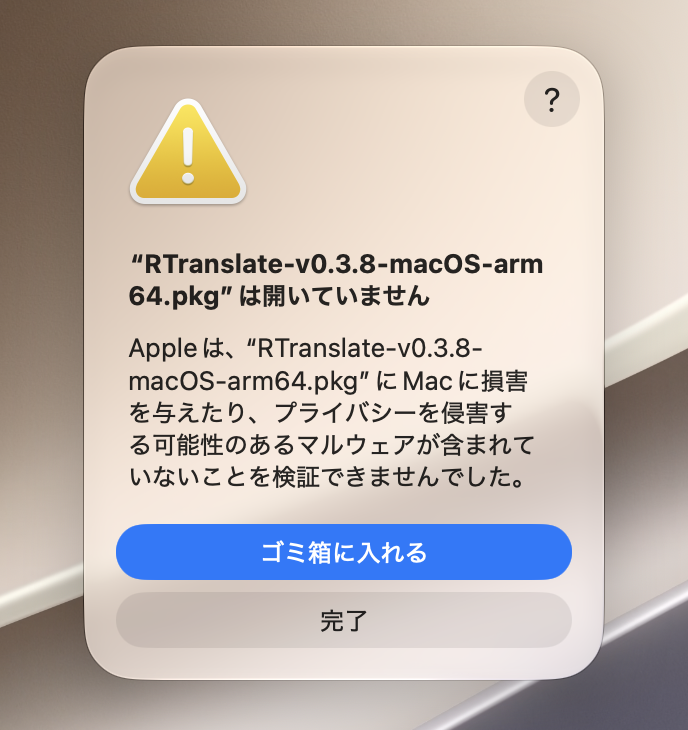
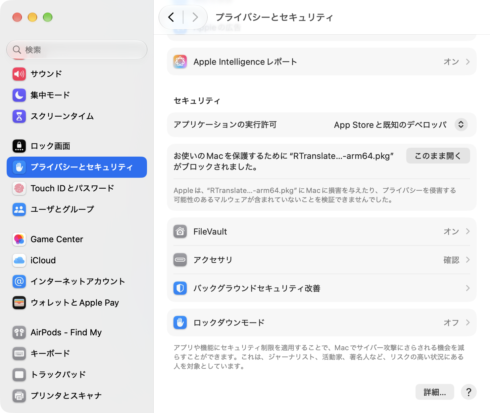
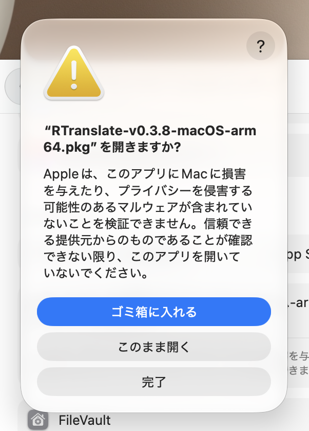
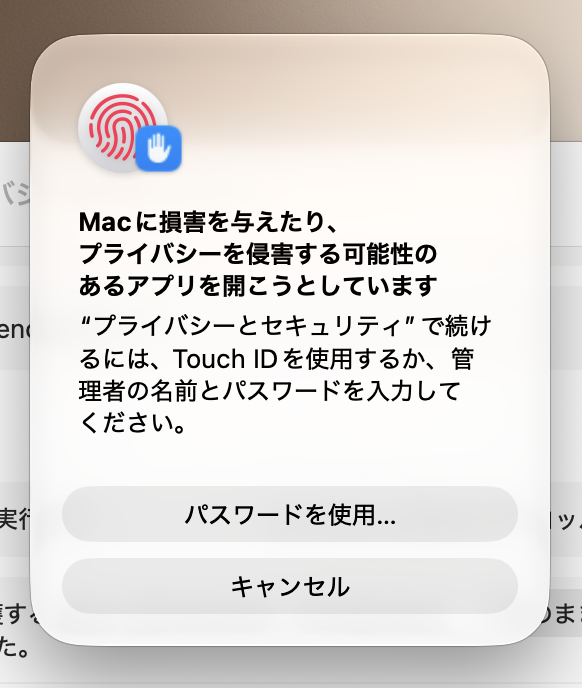
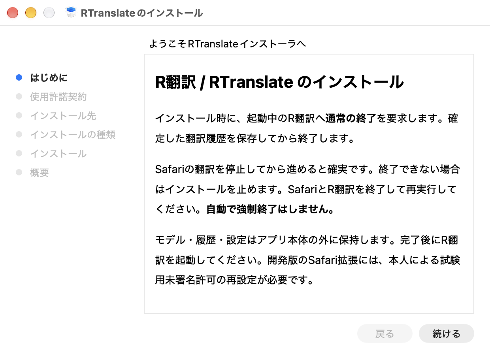
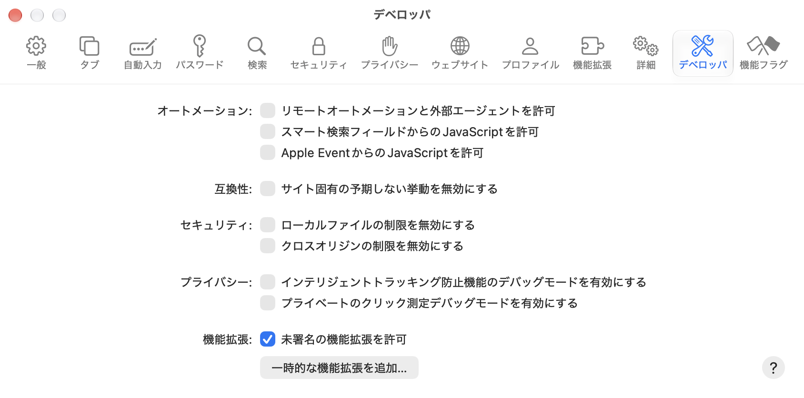
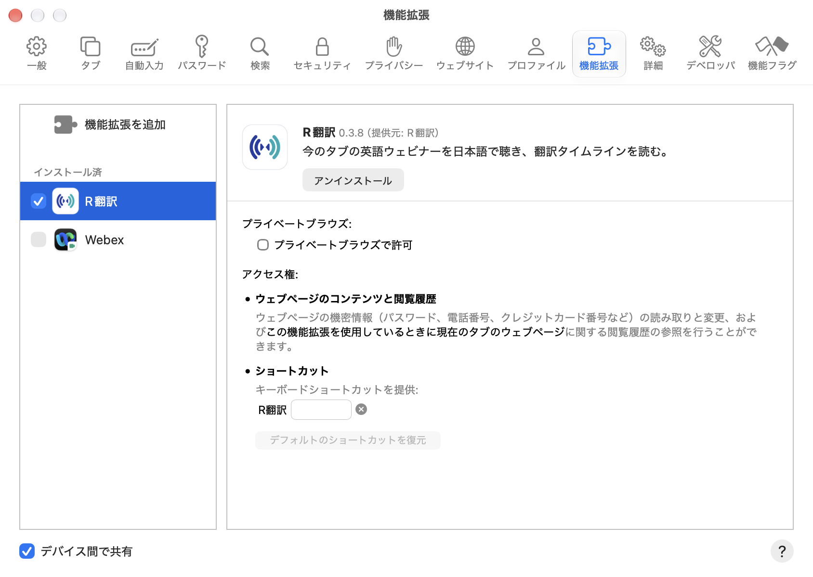

# R翻訳 / RTranslate のインストール

[READMEへ戻る](../README.md) · [インストーラをダウンロード](https://github.com/haruxbt/RTranslate/releases/download/v0.4.1/RTranslate-v0.4.1-macOS-arm64.pkg) · [ほかのバージョン](https://github.com/haruxbt/RTranslate/releases)

Apple Silicon（Mシリーズ）・macOS 26以降が対象です。ソースのビルドやXcodeの導入は不要です。このページの画面例はv0.3.8です。macOS・Safariのバージョンにより、文言や配置が異なる場合があります。

現在は未公証・仮署名の個人開発版のため、初回はmacOSでインストーラを個別に許可し、Safariで開発版の拡張を有効にします。Mac全体のセキュリティ機能を無効にする操作や、ターミナルのコマンドは不要です。ここから案内するGitHub Releasesの配布元とファイル名を確認して進めてください。

## 1. PKGを開き、警告は「完了」で閉じる

ダウンロードした <strong>RTranslate-v0.4.1-macOS-arm64.pkg</strong> をダブルクリックします。

「開いていません」「検証できませんでした」という警告が出たら、<strong>「完了」</strong>をクリックします。ここではまだインストールは始まっていません。<strong>「ゴミ箱に入れる」は選ばず、PKGを残してください。</strong>

警告が出ずインストーラが開いた場合は、次の手順の「インストーラで進める」へ進みます。

## 2. 「このまま開く」でインストールする

### システム設定で、このPKGを許可する

アップルメニューから <strong>「システム設定 → プライバシーとセキュリティ」</strong>を開き、下へスクロールします。

「セキュリティ」欄にある、RTranslateのPKGがブロックされたという表示の右側で <strong>「このまま開く」</strong>をクリックします。

確認画面が出たら、ファイル名を確認して、もう一度 <strong>「このまま開く」</strong>をクリックします。「ゴミ箱に入れる」は選びません。

Touch IDまたは管理者のパスワードを求められたら、Macの画面上で認証します。

### インストーラで進める

インストーラが開いたら <strong>「続ける」</strong>を押し、利用規約を確認して画面の案内に沿って進めます。完了したらインストーラを閉じます。

アプリケーションフォルダの <strong>「R翻訳」</strong>（英語環境では「RTranslate」）を起動します。初回はPLaMoとVOICEVOXのモデルを別途ダウンロードするため、準備完了まで待ちます。インストール後もMacアプリは、Safari拡張の翻訳・読み上げを処理します。

## 3. Safariで未署名の機能拡張を許可する

Safariを開き、メニューバーの <strong>「Safari → 設定…」</strong>（⌘,）を選びます。

<strong>「デベロッパ」</strong>タブを開き、機能拡張の欄にある <strong>「未署名の機能拡張を許可」</strong>をONにします。

この手順で必要なのは「未署名の機能拡張を許可」です。画像内のクロスオリジン制限、ローカルファイル制限、オートメーションなど、ほかの項目は変更不要です。

「デベロッパ」タブが見当たらない場合は、「詳細」で「Webデベロッパ用の機能を表示」をONにしてから確認してください。「Safari機能拡張…」から別の画面が開いた場合も、「Safari → 設定…」から進めます。

## 4. R翻訳を有効にする

同じSafari設定の <strong>「機能拡張」</strong>タブへ移り、左側の <strong>「R翻訳」</strong>にチェックを付けます。

設定を閉じ、翻訳したい動画のページを再読み込みします。動画を再生し、SafariのR翻訳アイコンから <strong>「翻訳開始」</strong>を押します。ページ内に「音声を接続して翻訳する」が出た場合は、そのボタンも押してください。

これで準備完了です。Macアプリのウィンドウを赤いボタンで閉じても翻訳は続きますが、メニューバーからアプリを「終了」すると翻訳も停止します。

## アップデートするとき

新しいPKGで上書き更新できます。モデル・履歴・設定は引き継ぎます。

Safariの翻訳を停止してから進めると確実です。インストーラは起動中のR翻訳へ通常終了を要求します。終了できない場合は更新を中止するので、SafariとR翻訳を終了して再実行してください。自動で強制終了はしません。

すでに拡張が有効なら、更新のたびにSafari設定を変更する必要はありません。利用者のAirでは、v0.3.6稼働中からv0.3.7へ更新し、再許可・拡張の再指定なしで継続利用できたことを確認しています。Safari自体を終了・再起動すると試験用許可がリセットされるため、拡張が表示されない場合は手順3・4を確認してください。

## 途中で進めなくなったら

- <strong>「このまま開く」がない</strong>：PKGを一度ダブルクリックして警告を閉じ、その直後にシステム設定を確認します。
- <strong>「R翻訳」が機能拡張にない</strong>：アプリケーションフォルダのR翻訳を一度起動し、手順3を確認します。
- <strong>翻訳開始が使えない</strong>：Macアプリのモデル準備が完了しているか確認します。動画のあるページを開き、再生してから開始します。

操作の詳細は、[Apple：Macでアプリを安全に開く](https://support.apple.com/ja-jp/102445)、[Apple：Safari機能拡張のトラブルシューティング](https://developer.apple.com/documentation/safariservices/troubleshooting-your-safari-web-extension)も参照できます。
